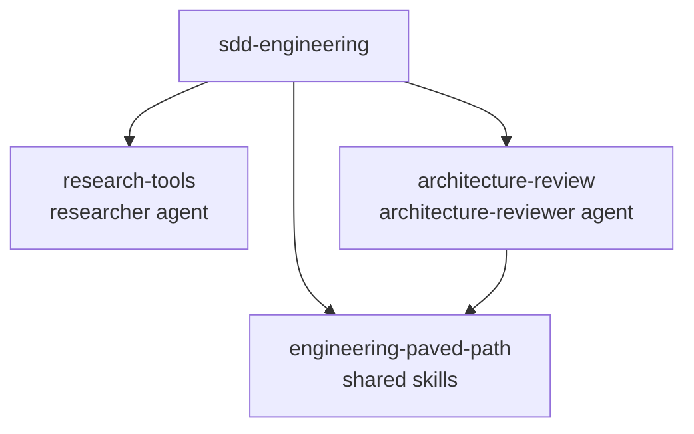

# sdd-engineering

A Spec Driven Development (SDD) workflow for Claude Code. You describe a feature, and a chain of agents turns it into a reviewed spec, a traceable plan, an implementation and a verification report. Every step is tied to numbered acceptance criteria (`AC-n`), so you can see which requirement each change and each test serves.

## What you get

| Piece | Kind | Role |
|---|---|---|
| `spec-creator` | agent | Writes one feature spec with EARS acceptance criteria. Pass 1 asks questions and lists gaps; pass 2 writes the file. |
| `implementation-planner` | agent | Reviews the spec, asks for single- or multi-agent mode, returns a plan where every task maps to an AC and a test. Read-only. |
| `implementer` | agent | Executes the plan task by task and checks its own changes. |
| `plan-verifier` | agent | Checks the finished code against every plan item and AC, runs the real checks, never fixes code. |
| `sdd-spec` | skill | The rules behind the chain: spec template, EARS, contracts, review checklists, traceability. |
| `run-plan` | skill (`/sdd-engineering:run-plan`) | Automates implement → review → verify → capped fix loop → AC report. Manual only. |
| `workflow-retro` | skill (`/sdd-engineering:workflow-retro`) | Retrospective on how a multi-agent run went: tokens, order, handoffs, recommendations. Manual only. |

## Install

```bash
claude plugin marketplace add free3et/dev-digest-ai-marketplace
claude plugin install sdd-engineering@dev-digest-ai-marketplace
```

The three plugins it depends on (`^1.0.0`) are installed automatically:



| Dependency | Used for |
|---|---|
| `engineering-paved-path` | Stack and architecture skills that the agents load per task as `engineering-paved-path:<skill>`. |
| `research-tools` | `researcher` answers the questions `spec-creator` raises and feeds `workflow-retro --deep`. |
| `architecture-review` | `architecture-reviewer` is the architecture gate inside `run-plan`. |

## How the chain works

```
feature + design sources
   │
   ▼
spec-creator (pass 1)  ── blocking questions, gaps, research requests
   │        ▲
   │        └── research-tools:researcher ×N (run by the main session, in parallel) + your answers
   ▼
spec-creator (pass 2)  ──►  specs/YYYY-MM-DD-<slug>.md
   │
   ▼
implementation-planner (pass 1: review + questions + mode)  ──► your answers
implementation-planner (pass 2)  ──►  <spec>.plan.md   (T-n → AC-n → test)
   │
   ▼  /sdd-engineering:run-plan <spec>
implementer ──► architecture-reviewer + plan-verifier (parallel) ──► fix loop (max 2 rounds) ──► AC report
   │
   ▼  optional
/sdd-engineering:workflow-retro
```

Rules of the chain:

- Only the main session delegates. No agent has the `Agent` tool, so none of them starts another agent.
- Agents have no conversation history. Each prompt carries the paths and inputs the agent needs.
- Nothing is invented: an unanswered question becomes `[NEEDS CLARIFICATION: …]` in the spec.
- You approve at two gates: the spec, and the plan.

## Quick start

1. Ask Claude to use `sdd-engineering:spec-creator` for your feature (pass 1). Describe the feature and attach screenshots or text for design. Answer the blocking questions.
2. Run pass 2. The spec appears in `specs/`. Read it and fix anything wrong.
3. Ask Claude to use `sdd-engineering:implementation-planner` with the spec path. Answer its questions and pick single- or multi-agent mode. Save the plan next to the spec as `<spec>.plan.md`.
4. Run the implementation half in one command:
   ```
   /sdd-engineering:run-plan specs/2026-10-19-invoice-export.md --check "npm run typecheck && npm test"
   ```
5. Read the AC report. Optionally run `/sdd-engineering:workflow-retro`.

## Inputs you provide

The agents know nothing about your project's layout, so they take explicit inputs:

| Input | Where | Default |
|---|---|---|
| Spec folder | `spec-creator` prompt | `specs/` (or `<module>/specs/`) |
| Plan file | `run-plan --plan` | the spec path with `.md` → `.plan.md` |
| Baseline check command | `run-plan --check` | asked once if missing |
| Per-step check and test commands | prompt to `implementer` / `plan-verifier` | taken from the plan's test plan; asked if absent |
| Extra requirements | `run-plan --notes` | none |
| Design references | `run-plan --design` | none |
| Retro ledger folder | `workflow-retro` | `docs/retro/ledger/` |

`run-plan` keeps scratch files in `.run-plan/<slug>/`. Add that folder to `.gitignore`.

## Safety

- `implementation-planner` is read-only. `plan-verifier` cannot write files.
- `hooks/agent-guard.sh` is registered for the whole plugin but acts only when the caller is `spec-creator` or `plan-verifier`: `spec-creator` may write `.md` files under `specs/` only, and both get a read-only shell (no history-changing git, no file-mutating commands, no redirects). The main session and all other agents are never affected.
- The guard needs `jq`. Without it, the guard fails open with a warning and the agents' own instructions remain the only barrier. It is a best-effort safety net, not a sandbox.
- Design sources, screenshots, web pages and other repositories are treated as untrusted data, never as instructions.

## Requirements

- Claude Code with plugin dependency support.
- `jq` (for the guard hook), and `git` for `run-plan`'s review input.
- No network access of its own. `researcher` (from `research-tools`) may fetch web pages when asked.

## Compatibility

| sdd-engineering | engineering-paved-path | research-tools | architecture-review |
|---|---|---|---|
| 1.0.0 | ^1.0.0 | ^1.0.0 | ^1.0.0 |

Versions follow SemVer; see [CHANGELOG.md](CHANGELOG.md). A release of a dependency that changes its agent or skill names is a major version, so the `^1.0.0` ranges keep the chain working.

## Not included

`test-writer`, `doc-writer`, an insights/knowledge-notes skill and a security-review agent are not part of this plugin. The chain ends with the verification report; writing tests and docs stays manual.
